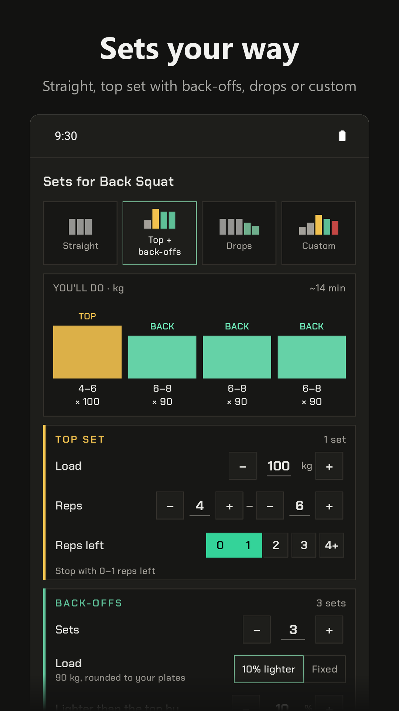
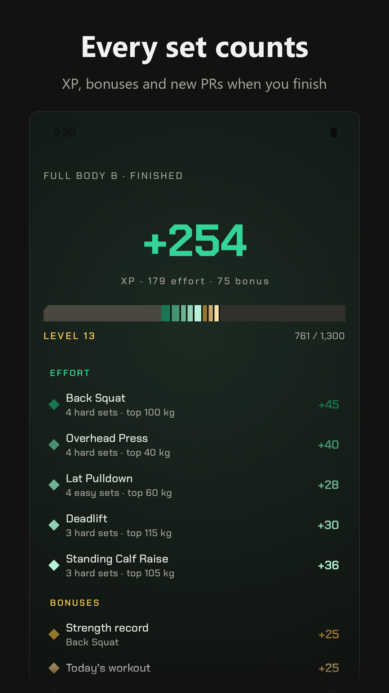
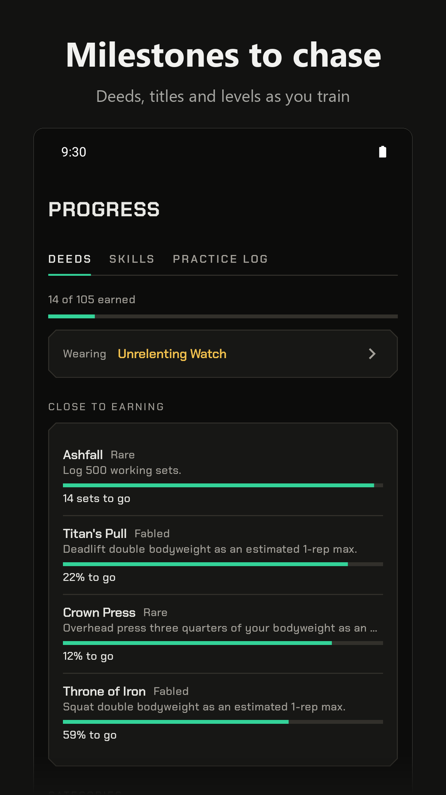
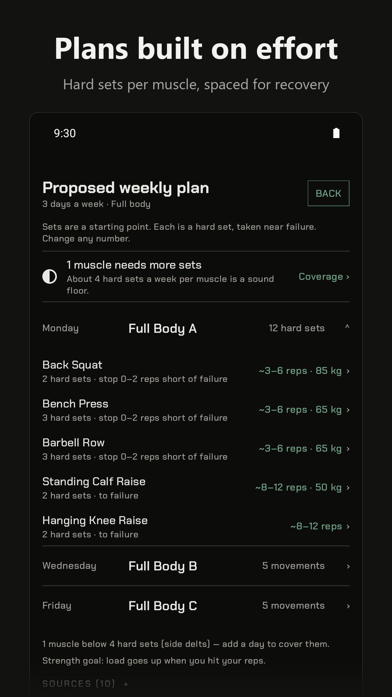
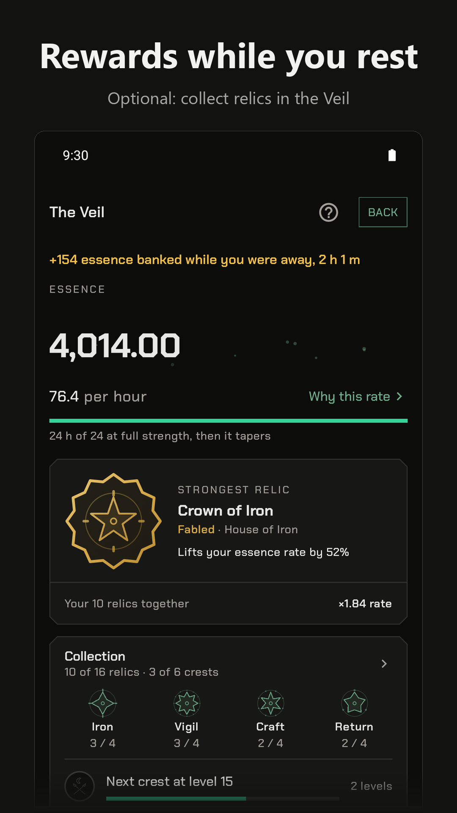

<div align="center">


# Ironvellum

**An offline-first strength training app that scores what you actually lift.**

<a href="https://f-droid.org/packages/com.ironvellum.app/"></a>
<a href="https://apps.obtainium.imranr.dev/redirect?r=obtainium://app/%7B%22id%22%3A%22com.ironvellum.app%22%2C%22url%22%3A%22https%3A%2F%2Ff-droid.org%2Fpackages%2Fcom.ironvellum.app%2F%22%2C%22author%22%3A%22AlexMollard%22%2C%22name%22%3A%22Ironvellum%22%7D"></a>

[](https://f-droid.org/packages/com.ironvellum.app/)
[](LICENSE)


</div>

---

## What it is

Ironvellum is a strength training app for Android that plans your week, logs
it set by set, and shows you what is working. Nothing needs an account, a
signal or a subscription.

Plans are built around effort, not guesswork: hard sets taken close to
failure, a weekly floor for every muscle and a cap so none is buried. Most
trackers add up kilograms, which rewards being heavy; Ironvellum scores a set
by what it cost you, with your bodyweight factored in, so the number is one
you can chase without gaming it.

The app uses plain gym words by default. If you want the fantasy, turn on
**Themed names** in Settings and a routine becomes a **rite**, a workout a
**trial**, your history the **Chronicle**. The reward layer (deeds, crests,
relics and the Veil) keeps its names either way. Every word is defined in
[docs/GLOSSARY.md](docs/GLOSSARY.md).

<div align="center">

| | | | |
|:---:|:---:|:---:|:---:|
|  |  |  |  |
|  |  |  |  |

</div>

## Features

### Getting started

- **Make it yours:** pick plain or themed names, kg or lb and an accent colour
  before anything else.
- **Setup** asks who you are, your equipment, what you are chasing and how you
  rate effort (reps left or RPE), then builds an editable weekly plan from the
  real catalogue, starting loaded lifts on sensible weights. Skip it and build
  your own instead.
- **Today** is one status page: the routine your plan puts on today, your
  level, streak and Strength Rank, and the way into the Veil. Swipe between
  days.

### Planning

- **The plan builder** (the Forge, in themed names) builds a week in three
  steps around effort: hard sets with reps in reserve, a weekly floor per
  muscle, a cap so none is buried, days spaced for recovery and a session that
  fits your clock. Each slot offers three ranked suggestions.
- **Weekly coverage** shows the hard sets each muscle gets against its target,
  short muscles first, and **Optimise routines** fills the gaps in a tap.
- **Set schemes per lift:** straight sets, a top set with back-offs, drop sets
  or your own mix, drawn as bars in the Sets sheet so you can read the plan at
  a glance. Rep ranges progress by double progression, and back-offs fill in
  from the top set and round to the plates you own.
- **Warm-ups:** ramps for loaded lifts, and warm-up exercises in a routine that
  never count toward your stats.
- **Over 570 exercises**, each with a line drawing and a swipeable info sheet
  of the muscles it works, plus your own exercises with their muscles and gear.
  Records and progression are kept apart per variation.

### Training

- **Live workout.** One exercise open at a time and a docked action bar.
  - Log a set in a tap; a load or rep count you change carries to the later
    sets.
  - Rate effort by reps left or RPE, asked under the exercise it belongs to.
  - Rest timer with -15 s and +15 s, a suggested maximum and lock-screen
    controls; a pocket lock, keep-awake and tick haptics.
  - Supersets, hold timers with a get-ready count, and a distance stopwatch.
  - A plate calculator that finds every exact build, weighted vest and dip
    belt loads, kg or lb.
  - Notes per exercise, Undo on removal, and continue a workout you left.
- **When you finish**, tick which of today's changes go back into the
  routine: loads, reps, added exercises and new supersets. Edit a finished
  workout later, or delete it.

### Progress

- **Body-scaled scoring.** A rep is worth `reps × (bodyweight + added) /
  bodyweight^0.67`, the allometric exponent. Loads are converted per
  implement, movements are weighted by difficulty, and strength is normalised
  by muscle group with per-sex standards (held until you choose).
- **PRs that agree everywhere:** a lift's page, its chart, the Stats board and
  the live "New PR" tag all use its best estimated 1RM.
- **XP, levels and Strength Rank**, built from your best marks on pull, push
  and legs, with XP earned by effort.
- **Stats** charts body (weight, body fat, BMI, FFMI), training (lift records
  and a calendar) and daily measurements. Health Connect reading is optional.
- **125 skills** on progression paths (pull, push, handstand, lever, planche,
  rings, legs, core, mobility and the barbell ladders), each gated on the one
  before it with a written standard, and **105 deeds** to earn.
- **Share a workout** as plain text in the shape of a Wordle grid: a row per
  movement, a square per set, a trophy on a record set. No link, no image.
- **The Veil** is an idle layer: workouts leave echoes, echoes gather essence
  while you are away, and you spend it on relics in houses with set bonuses.
  **28 crests** are worn for a small Veil-only perk and shown to your friends.

### Friends

Optional, and only with an account.

- Add friends and read their feed, with kudos and comments.
- Form a **group** of 2 to 8 with a shared weekly goal.
- Climb **the leaderboard** for each lift.

### Your data

- Everything is stored on the phone first.
- Export a full JSON archive or a CSV of your workouts, and import the archive
  again.
- Import workouts from a Strong, Hevy or FitNotes CSV.
- Delete your cloud account from inside the app at any time.

## Install

- **F-Droid:** [Ironvellum on F-Droid](https://f-droid.org/packages/com.ironvellum.app/).
  The `foss` build carries no proprietary libraries.
- **Obtainium:** [add Ironvellum](https://apps.obtainium.imranr.dev/redirect?r=obtainium://app/%7B%22id%22%3A%22com.ironvellum.app%22%2C%22url%22%3A%22https%3A%2F%2Ff-droid.org%2Fpackages%2Fcom.ironvellum.app%2F%22%2C%22author%22%3A%22AlexMollard%22%2C%22name%22%3A%22Ironvellum%22%7D) to track the F-Droid build.
- **Releases:** tagged versions are on
  [GitHub Releases](https://github.com/AlexMollard/Ironvellum/releases).
- **From source:** needs a JDK and the Android SDK.

  ```bash
  git clone https://github.com/AlexMollard/Ironvellum.git
  cd Ironvellum
  ./gradlew :app:assembleFossDebug
  ```

  Two flavours share one application id. `foss` is the F-Droid and GitHub
  build and shows support links. `play` adds Google sign-in and shows none;
  build it with `assemblePlayDebug`. The app needs Android 10 (API 29) or
  newer.

## Privacy and data

Ironvellum works with no account and no network. All training data lives in a
local database, which Android's own backup does not copy.

If you sign in, the app syncs your training record and nothing more: finished
workouts and their sets, display name, visibility, earned titles, kudos and
friends. Body measurements and everything read from Health Connect never
leave the device. You can export or import your data at any time.

The cloud is optional and does not have to be ours. Settings, then Cloud,
accepts any Supabase project of your own, hosted or self-hosted. See
[supabase/SELF_HOSTING.md](supabase/SELF_HOSTING.md).

Full statement: [PRIVACY.md](PRIVACY.md) and
[Play Data Safety answers](docs/PLAY_DATA_SAFETY.md).

## For developers

Kotlin 2.4.20, Jetpack Compose with Material 3, Room 2.8.5, WorkManager,
Health Connect 1.1.0 (read only), and Supabase 3.8.0 over Ktor 3.5.2. AGP
9.4.0, minSdk 29, targetSdk 36. The domain layer is pure Kotlin, which is why
most of it is covered by fast unit tests. Room is the source of truth; the
cloud is a backup, never an authority.

**Tests run locally.** The workflows are manual (`workflow_dispatch`) only;
the gate runs on your machine:

```bash
python3 tools/gate.py              # build, unit, lint, instrumented
python3 tools/gate.py --backend    # plus the Supabase schema assertions (Docker)
python3 tools/gate.py --no-device  # no emulator: compiles instrumented instead
```

> [!WARNING]
> The instrumented suite calls `pm clear`, deletes rows from the app's own
> database and uninstalls the app. Pointed at a phone with real training on it,
> it destroys that history. `tools/gate.py` pins the run to an emulator and
> refuses a physical device unless you pass `--serial`. If you run Gradle by
> hand, pin it yourself:
> ```bash
> ANDROID_SERIAL=emulator-5554 ./gradlew :app:connectedFossDebugAndroidTest
> ```

`python tools/device.py up` boots the emulator, and `install`, `launch` and
`shot` drive it. Cloud defaults live in `cloud-defaults.properties`;
`local.properties` (gitignored) overrides them and holds the Google sign-in
and release signing keys.

Depth lives in `docs/`:

- [docs/DESIGN.md](docs/DESIGN.md) - the Clean look
- [docs/GLOSSARY.md](docs/GLOSSARY.md) - every word the app shows
- [docs/RELEASE_CHECKLIST.md](docs/RELEASE_CHECKLIST.md) - what ships before a release
- [docs/TODO.md](docs/TODO.md) - outstanding work
- [docs/open-source/](docs/open-source/README.md) - open-sourcing, funding and self-hosting plans
- [COSTS.md](COSTS.md) - what the shared cloud costs
- [AGENTS.md](AGENTS.md) - standing rules for agents working in the repo
- [docs/archive/GOAL.md](docs/archive/GOAL.md) - the original v1 brief (historical)

## Licence and support

Ironvellum is free software under the
[GNU General Public License v3.0 or later](LICENSE), with no ads, trackers or
paid tier. Project artwork shares that licence; see
[docs/ART_ATTRIBUTION.md](docs/ART_ATTRIBUTION.md). The Chakra
Petch font is under the SIL Open Font License 1.1, and the muscle map's body
shapes derive from
[react-native-body-highlighter](https://github.com/HichamELBSI/react-native-body-highlighter)
(MIT). Exercise illustrations come from
[Open Exercise Art](https://github.com/AlexMollard/Open-Exercise-Art)
(CC BY-SA 4.0), inspired by [Everkinetic](https://github.com/everkinetic/data)
and [Workout Guide](https://github.com/bryllim/workout-guide). The exercise instructions
remain adapted from Everkinetic under CC BY-SA 4.0
(see [docs/ART_ATTRIBUTION.md](docs/ART_ATTRIBUTION.md)). See [NOTICE](NOTICE) and [THIRD_PARTY_NOTICES.md](THIRD_PARTY_NOTICES.md).

Bug reports and pull requests are welcome in
[Issues](https://github.com/AlexMollard/Ironvellum/issues). To help keep the
shared cloud running, support the project through
[GitHub Sponsors](https://github.com/sponsors/AlexMollard) or
[Liberapay](https://liberapay.com/AlexMollard); the `foss` build links to
both.
