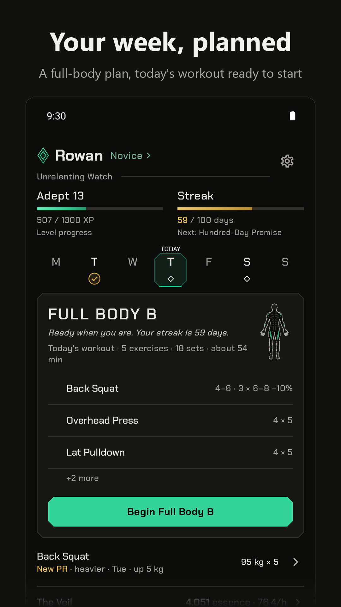
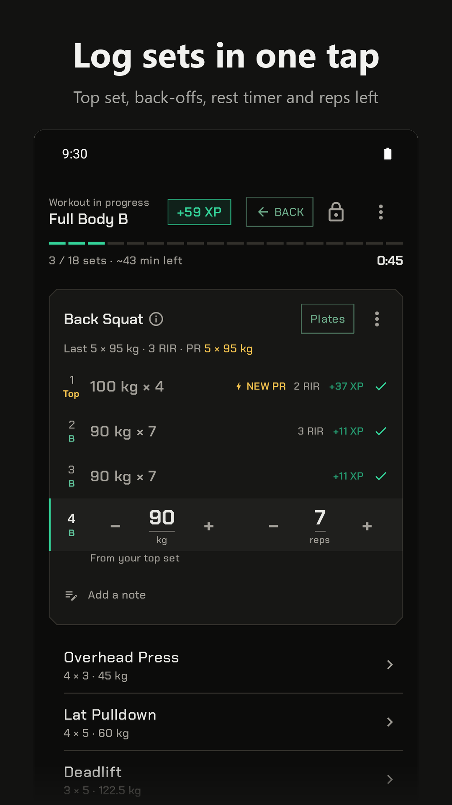
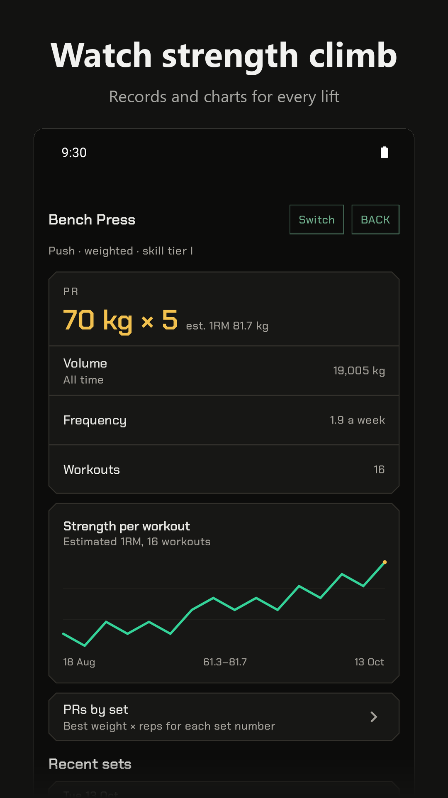
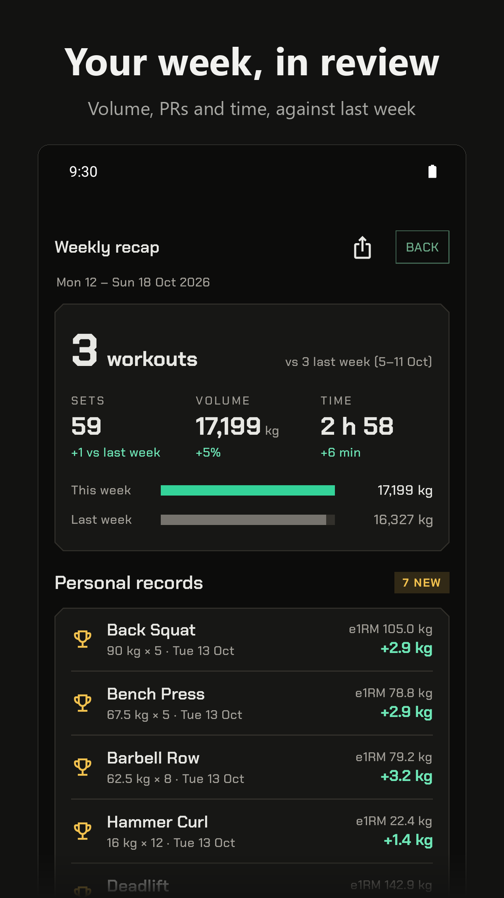
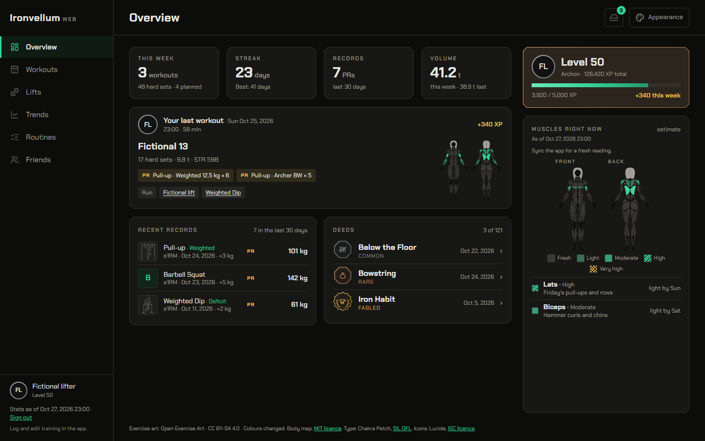

  

<h1 align="center">Ironvellum</h1>

  <strong>An offline-first strength training app that scores what you actually lift.</strong> 
  Plan your week, log it set by set and see what is working. No account, signal or subscription needed.

  
  
  
  

  <a href="https://f-droid.org/packages/com.ironvellum.app/">Get it on F-Droid</a> ·
  <a href="https://alexmollard.github.io/Ironvellum/">Web dashboard</a> ·
  <a href="docs/FEATURES.md">Features</a> ·
  <a href="#documentation">Documentation</a>

  
  
  
  

## What is Ironvellum?

A strength training app for Android that plans around effort instead of guesswork. Most trackers add up kilograms, which rewards being heavy. Ironvellum scores a set by what it cost you, with your bodyweight factored in.

- **Plan:** a weekly plan built around hard sets, a floor for every muscle and days spaced for recovery.
- **Train:** a fast live workout with rest timers, supersets, a plate calculator and lock-screen controls.
- **Progress:** body-scaled scoring, PRs that agree everywhere, 125 skills, 121 deeds and weekly recaps.
- **Recover:** a per-muscle fatigue estimate that suggests when to lighten, swap or rest.
- **Your data:** stored on the phone first, exported or backed up whenever you like, cloud sync optional.

Plain gym words by default; turn on **Themed names** for the fantasy version. The full list is in [Features](docs/FEATURES.md).

## Web dashboard

  

Signed-in lifters can read their training on a computer at **[alexmollard.github.io/Ironvellum](https://alexmollard.github.io/Ironvellum/)**: overview, workouts, lifts and trends. It is read-only and private to you; logging and editing stay in the app.

## Install

- **[F-Droid](https://f-droid.org/packages/com.ironvellum.app/)**, or track it with **[Obtainium](https://apps.obtainium.imranr.dev/redirect?r=obtainium://app/%7B%22id%22%3A%22com.ironvellum.app%22%2C%22url%22%3A%22https%3A%2F%2Ff-droid.org%2Fpackages%2Fcom.ironvellum.app%2F%22%2C%22author%22%3A%22AlexMollard%22%2C%22name%22%3A%22Ironvellum%22%7D)**.
- Tagged builds are on [GitHub Releases](https://github.com/AlexMollard/Ironvellum/releases). To build it yourself, see [Development](docs/DEVELOPMENT.md).

## Privacy

Ironvellum works with no account and no network. If you sign in, it syncs your training record and nothing more, and you can point it at your own Supabase project instead of ours. Raw body measurements and Health Connect data stay on the phone; your private web snapshot only carries strength estimates derived from them. Read the [privacy policy](PRIVACY.md).

## Documentation

| Guide | Covers |
|---|---|
| [Features](docs/FEATURES.md) | Everything the app does, by area |
| [Glossary](docs/GLOSSARY.md) | Every word the app shows, plain and themed |
| [Development](docs/DEVELOPMENT.md) | Stack, building from source, the local test gate |
| [Web dashboard](web/README.md) | The web viewer's code, fixtures and deployment |
| [Self-hosting](supabase/SELF_HOSTING.md) | Running the cloud on your own Supabase project |
| [Design](docs/DESIGN.md) | The look, themes and components |
| [Translating](docs/TRANSLATING.md) | Helping translate the app |
| [Roadmap](docs/TODO.md) | What is planned next |

Tests run locally with `python3 tools/gate.py`. GitHub workflows are manual-only; pushing runs no checks.

## Licence

Free software under the [GPL-3.0-or-later](LICENSE), with no ads, trackers or paid tier. Exercise art comes from [Open Exercise Art](https://github.com/AlexMollard/Open-Exercise-Art) (CC BY-SA 4.0); other credits are in [ART_ATTRIBUTION.md](docs/ART_ATTRIBUTION.md) and [THIRD_PARTY_NOTICES.md](THIRD_PARTY_NOTICES.md).

Issues and pull requests are welcome. Support the shared cloud through [GitHub Sponsors](https://github.com/sponsors/AlexMollard) or [Liberapay](https://liberapay.com/AlexMollard).
