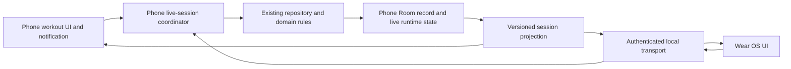

# F-Droid-compatible Wear OS live workout companion

Date: 2026-11-13

**Status: plan and six-screen design direction approved by Alex on 2026-11-13; phase-zero prototype work authorized.** Alex subsequently confirmed hardware is unavailable now (first intended watch: Galaxy Watch6) and explicitly approved building/checking the isolated prototype while leaving the hardware gate unpassed. Production workout integration remains gated on transport proof. A proprietary bridge, cloud dependence, support exclusions and a release are not approved.

## 1. Product contract

Build a cross-brand **Wear OS control surface for the phone's current workout**, compatible with Ironvellum's F-Droid distribution. It is not a separate logger that uploads a finished workout later.

The phone owns the workout record. Phone and watch show the same current movement, set figures, completion state, effort and timers. Commands from either surface update the other promptly while connected. Cloud sign-in, an internet connection and Samsung-specific SDKs must not be prerequisites.

Three defining examples:

1. Start a workout on the phone, open Ironvellum on the watch, increase the displayed set from 8 to 10 reps and change its load. The phone shows the confirmed changes without reopening the screen. Complete that exact set on the watch, then rate it RPE 8; both surfaces show it logged and rated, and the correct rest begins once.
2. Start a timed hold on either surface. Both show the five-second get-ready phase and the same count-up toward the target. Reaching the target cues without logging. Stop, adjust the actual seconds and log from the watch; the phone records the same result.
3. The phone removes or completes the set while the watch has an old screen, or the connection drops after a tap. The old command must never affect a different set. The watch shows a conflict or an unconfirmed action, refreshes authoritative state and never invents a saved result.

### Scope and defaults

- Target compatible **Wear OS watches across manufacturers**, not just Galaxy Watch. Start feasibility testing with Wear OS 3+; final OS/API floor follows the actual transport and build proof.
- Do not promise every device marketed as an Android-compatible smartwatch. Tizen, watchOS, Garmin, Huawei and Amazfit platforms are not covered by a Wear OS APK.
- Fully FLOSS phone and watch artifacts, direct local communication and no account are the preferred design. This remains a feasibility goal, not an established capability.
- Phone-first session authority; no independent offline watch session or multi-master workout merge in this project.
- One controlling watch paired to a phone initially. No arbitrary watch-count framework; explicitly replace/forget the paired watch. Multiple-watch control would be a separate approved requirement.
- Existing phone operation must remain intact when the watch feature is disabled, absent, incompatible or disconnected.
- Workout control parity is not a tiny-screen port of the app's social, routine-authoring, photo or game interfaces.
- New watch-started workouts are a proposed convenience, not required to satisfy Alex's phone-started-session example. Keep the no-active-workout screen useful without adding an independent routine database.

### Engineering pillars

| Pillar | Concrete requirement |
|---|---|
| Correctness and data safety | One committed workout, no wrong-set actions, lost concurrent edits, double awards or guessed timer records |
| Scalability | Work scales with the active session, not total history; bounded frames, queues, receipts and reconnect work |
| Six-month maintainability | Reuse repository/domain rules and one command path; choose one proven transport, not a fleet of fallback implementations |
| Efficiency | Push changes and interpolate clocks locally; no per-second database writes, radio polling or always-on discovery |
| Privacy and offline operation | No account/server needed; scoped pairing, encrypted transport and no health/cloud credentials on the wire |
| F-Droid continuity | Keep proprietary SDKs out of the FOSS dependency graph and final artifacts; installation must not replace or wipe the existing app |

## 2. Verified foundations and gaps

Paths below are relative to the repository root. Line numbers describe the source inspected for this plan, not a fixed future API. The working tree contains concurrent unrelated changes; implementation must rebase its understanding on current source rather than an old plan or schema number.

| Source | Existing behaviour to reuse | Watch integration gap |
|---|---|---|
| `settings.gradle.kts:23-24` | Only `:app` is included | No watch module or transport |
| `app/build.gradle.kts:88-101,223-249` | Separate `foss` and `play` distributions; FOSS excludes proprietary credential libraries | Wear transport must preserve this boundary |
| `data/LiveTrialActions.kt:16-106` | Shared screen/notification set facade, process-wide mutex, metric-specific writes and rest rules | `commit` accepts caller snapshots; rest is started before the repository write; no durable remote-command receipt |
| `data/Repository.kt:1626-1877` | Transactional set edits, kinds, effort, load propagation and extra-set insertion | Add explicit remote preconditions/results; never bypass these rules with direct DAO writes |
| `data/Repository.kt:1938-1982,2116-2212` | Removal/restore, sealing/scoring and optional asynchronous Health Connect write-back | Retry-safe remote finish/result and stale-target handling |
| `domain/Models.kt:97-167` | Set IDs, block positions, reps, load, duration, distance, grade, kind, superset and RPE | Wire projection must preserve metric meaning and session lifetime |
| `ui/train/SessionScreen.kt:939-950,1103-1125` | Next-set ordering plus a manually selected open block | Active movement override is screen-local saved UI state, not shared workout state |
| `ui/train/SessionScreen.kt:645-678` | Rest flow and per-set `SetClock` map | Set clocks live in a ViewModel; remote control cannot depend on that screen existing |
| `ui/train/SessionScreen.kt:2394-2485` | Metric-aware steppers, unit/load grids and typed values | Extract only necessary pure input policies; do not copy these rules into watch UI |
| `ui/train/TimedSetControl.kt:51-59,79-193` | Readiness, target cues, stop/adjust/log and distance stopwatch | Cue/transition ownership currently includes Compose effects |
| `data/RestClock.kt`, `domain/RestTimer.kt` | Session-scoped monotonic rest; extend/shorten/cancel and guarded finish | Rest is process-memory state, not durable |
| `domain/SetClock.kt:3-24` | Pure monotonic timer; holds/durations count up after readiness | No persisted clock or cross-device clock mapping |
| `data/PreparationRepository.kt`, `domain/PreparationProgress.kt` | Persisted immutable preparation snapshot, guarded unit transitions, readiness, pause and expiry | Adapt runner ownership without duplicating the reducer |
| `ui/preparation/PreparationRunnerViewModel.kt:37-50` | Transactions finish before navigation; explicit leave pauses | Leaving one surface must not unexpectedly interrupt a handed-off execution surface |
| `TrialActionReceiver.kt:12-57`, `WorkoutSessionService.kt` | Explicit notification actions and a foreground live-session observer | Keep receiver private; watch requests must use a separately authenticated ingress |

Prefix `data/`, `domain/` and `ui/` above with `app/src/main/kotlin/com/ironvellum/app/`.

**Current code beats historical specifications.** In particular, the inspected `PreparationProgress.advance` handles `TIMER_EXPIRED` by completing the matching current timed unit and starting the next unit from now. Older preparation plans saying expiry never advances are not the current implementation contract. Do not rewrite that behaviour accidentally while adding watch support.

## 3. Transport decision: prove the FOSS route first

### 3.1 What is known

- Google's Wear Data Layer is part of Google Play services. Its documented phone/watch pairing requires matching package names and signing certificates. It can route through Google infrastructure when Bluetooth is unavailable. [Data Layer documentation](https://developer.android.com/training/wearables/data/overview).
- F-Droid prohibits proprietary libraries such as Google Play services in included applications. Open-sourcing our own wrapper does not make those linked dependencies free. [F-Droid inclusion policy](https://f-droid.org/docs/Inclusion_Policy/).
- Android exposes native Bluetooth and companion association APIs, but the Wear documentation explicitly directs companion communication through Data Layer and cautions against low-level sockets. A direct native Bluetooth implementation is therefore an **unsupported-by-Wear-guidance engineering experiment**, not a supported drop-in replacement.
- Companion Device Manager can assist association and background permissions; it neither creates the connection nor provides continuous scanning. [Companion pairing documentation](https://developer.android.com/develop/connectivity/bluetooth/companion-device-pairing).
- Bluetooth permissions differ by platform version; ask only when enabling watch connectivity, not at ordinary app startup. [Bluetooth permissions](https://developer.android.com/develop/connectivity/bluetooth/bt-permissions).

### 3.2 Candidate comparison

| Candidate | FOSS artifact goal | Meets local, no-account live control? | Decision |
|---|---|---|---|
| Native Android Bluetooth, starting with secure RFCOMM feasibility | Potentially phone and watch | Potentially; real hardware and background reliability unproven | Preferred research gate |
| BLE GATT | Potentially phone and watch | Potentially; peripheral/advertising capabilities and lifecycle need proof | Investigate only if RFCOMM evidence warrants it; do not ship both by default |
| Data Layer embedded in `foss` | No | Convenient, but proprietary and not strictly local-only | Reject |
| Separate Data Layer bridge and watch build | FOSS main phone APK only; companion path depends on proprietary components | No account may be possible, but Data Layer routing is not guaranteed local | Explicitly outside the default plan; needs Alex's approval |
| Internet/backend relay | Can use FLOSS client dependencies | Requires network/server; not the requested offline companion default | Not a silent fallback |
| LAN listener | Potentially | Same-network assumptions and a new listener; not a general gym solution | Do not build as default |
| microG Wear compatibility | Insufficient evidence | Not proven as a supported end-to-end route | Do not require a custom ROM, root or replacement Play services |

**Decision rule:** build no production workout feature around an unproven transport. If the native route fails the support matrix, return to Alex with the measured failure and choices. Do not quietly switch to a proprietary bridge, cloud relay or narrower brand coverage.

### 3.3 Prior art: useful, not proof

[Pocketdesk PR 622](https://github.com/sreevarshan-xenoz/Pocketdesk/pull/622), merged as `057a30bb6f21b96924c3a12dab22838396b95161`, describes a secure RFCOMM phone/watch path without Play services. Its own report explicitly leaves real Wear OS 3/4/5 hardware verification outstanding. It is design prior art, not evidence that our supported watches work. Review actual source, license and cryptography before reusing anything; do not copy an unaudited pairing protocol.

[microG PR 3837](https://github.com/microg/GmsCore/pull/3837) describes partial Wear transport work and explicitly lists physical pairing/discovery as unfinished. It is not a production dependency recommendation.

### 3.4 Phase-zero experiment

Create a disposable phone/watch pair of applications, separate from production signing and training data. Exchange an authenticated current-set snapshot, a figure edit, a completion command and a timer state. Do not build the full watch UI first.

Required experiments:

1. Connect over an app-specific secure RFCOMM service while the existing manufacturer watch companion remains paired and usable. Use public platform APIs, never hidden APIs or private Google protocol UUIDs.
2. Verify two-way push delivery with Wi-Fi and mobile data off but Bluetooth enabled. Verify no unexpected network path.
3. Phone foreground, phone locked/backgrounded, watch foreground, wrist lowered/ambient and watch app resumed. No permanent screen-on or battery-optimization exemption as a substitute for correctness.
4. Bluetooth toggle, out-of-range/reconnect, killed process, normal restart, phone reboot, watch reboot, revoked permission, force-stop and uninstall/reinstall. Force-stopped software may require explicit reopening; report that honestly.
5. Run a representative 60-minute workout workload, including timed units, repeated figure edits and an uninterrupted rest. Log latency, reconnects and energy relative to a phone-only/watch-idle baseline.
6. Verify coexistence with music/headphones, normal system watch connectivity and permission denial. Do not break the manufacturer's pairing to establish our link.
7. Verify separately signed FOSS phone/watch APKs, updates and restored phone data; direct transport must use explicit pairing rather than assuming identical app signatures.
8. Reject an unpaired client, altered frame, replayed request, wrong pairing confirmation, oversized frame and revoked peer.

Hardware coverage: at least one Galaxy Watch and one non-Samsung Wear OS watch; older supported and current OS generations; representative Samsung and non-Samsung phones. Include a Google-services-free phone if that runtime compatibility will be advertised. Emulator proof covers protocol/UI only, not a radio or OEM reliability claim. Expand the release matrix before claiming broad compatibility; record exact tested model/OS/phone combinations and untested rows.

**Proposed UX targets, not measurements:** during a healthy established local link, 95% of commands committed and reflected on the other visible surface within 500 ms; normal snapshot visible within 2 seconds of opening an already-paired watch app; reconnection and fresh snapshot within 5 seconds after the transport becomes available. Record p50/p95/worst and timeouts in both directions. Revisit targets only with explicit evidence and product agreement, not by silently relabelling lag as instant.

Phase-zero exit requires recorded hardware results, a selected single transport, an achievable lifecycle design, a dependency/license inventory and a security review of pairing. F-Droid maintainer acceptance and any public-store policy requirements remain separate distribution checks. A compiled demo is not a passed feasibility gate.

## 4. Workout control coverage

Every command targets a session instance and a concrete set/block/unit. The watch presents a compact primary screen plus an overflow editor; it must not offer a misleading generic completion button for every metric.

### 4.1 Daily controls

| Control | Watch behaviour | Shared rules and edge cases |
|---|---|---|
| Open/resume workout | Fetch authoritative snapshot and current movement; no active workout is a real empty state | Opening must not create a session, log a set or resume a paused preparation |
| Movement selection | Browse session blocks and explicitly select the active block | Distinguish repeated occurrences of the same exercise; phone selection propagates too |
| Reps | Minus/plus and direct bounded entry | One rep per normal step, zero floor; never overwrite a simultaneous load edit |
| Load | Minus/plus and direct entry; show kg/lb and per-hand meaning | Reuse current grid, worn-load and conversion rules; canonical storage remains kilograms |
| Assisted/bodyweight load | Label assistance, added resistance, bodyweight and unknown correctly | Positive assistance is not lifted external weight; null must not silently become zero; no sign inversion |
| Complete set | Explicitly complete the displayed set with committed figures | Distinct command ID; no toggle; enforce current existence, metric and completion state |
| Undo/unlog | Target the displayed completed set | Clear invalid RPE; cancel only the associated rest according to shared rules |
| Effort | Optional RPE chips or equivalent RIR scale; change/clear rating | Stored whole RPE 5-10; RIR is presentation; only logged, non-warmup, unsealed sets can be rated |
| Rest | Shared countdown, +15 s, -15 s and Skip | Respect rest-off preferences, top-set schemes, supersets, drops and final-set behaviour |
| Hold target | Edit seconds using existing five-second figure steps and direct entry | Seconds in `durationSec`, reps remain zero; target edit during a running clock changes the reference, not elapsed time |
| Duration activity | Edit duration, and load only when the metric/exercise uses it | Preserve seconds precisely; do not turn a 90-second result into a rounded minute merely by displaying an editor |
| Distance/time activity | Distance and duration entry, plus stopwatch Start/Stop | Canonical metres/seconds; Stop fills time without marking done; use existing rounding |
| Attempts/grade | Attempt count and grade editor | Attempts use the existing reps storage convention; preserve bounded grade text |
| Finish workout | Explicit confirmation using current logged/pending counts | Early finish asks about remaining work; empty workout must not earn a completion bonus |
| Abandon | Separate destructive confirmation, never adjacent to an unguarded primary action | Targets the session instance; no automatic abandon on disconnect or app exit |

Figure steppers must derive their policy from the phone/domain implementation rather than introducing a second set of constants. Watch-visible numeric limits must be safe at the protocol boundary even where a current UI stepper is less restrictive; reconcile with existing repository/domain bounds during implementation. Do not silently alter old stored data to meet a new input cap.

Edits and completion can be submitted as one command when the watch has an explicit local edit draft: validate and commit the changed fields plus `done=true` atomically. Alternatively flush confirmed edits before enabling Complete. Never race several unacknowledged figure writes against completion or rating.

### 4.2 Session structure and advanced actions

The phone already supports more than a checkbox. Account for these explicitly rather than treating them as unknown future cases:

| Existing action | Planned watch surface | Synchronization requirement |
|---|---|---|
| Add/remove a set and undo removal | Overflow actions; confirm where existing phone policy requires | Return authoritative IDs/order; repeating Add with the same command ID adds once |
| Repeated movement blocks | Distinct block entries | Exercise ID/name alone is never a block identity |
| Set kinds: working, warm-up, top/back-off/drop | Overflow where currently eligible | Warm-up sets remain unticked and excluded; respect top/drop eligibility and propagation |
| Add warm-up ramp, undo ramp | Overflow for eligible loaded movements | Preserve returned group identity and undo only that operation |
| Add drop/end drops and top-set conversion | Contextual overflow | Reuse existing repository refusals; do not create rests inside a drop chain |
| Superset order/link/unlink | Contextual session overflow | Same round and next-movement selection on both screens |
| Add/swap/remove/reorder movement | Compact session list and contextual selection/confirmation | Refresh block identity/focus; invalidate removed targets and stale confirmations |
| Modifiers and dedicated-exercise Switch/Keep decision | Contextual editor/decision | Preserve pending prompts and existing conversion semantics; don't let two surfaces answer different versions |
| Progression suggestion accept/dismiss/undo | Compact optional card/overflow | Undo must restore the correct original pending figures and not overwrite later edits |
| Apply load to following sets | Explicit scope in load editor | Determine exact eligible set IDs inside the transaction; preserve drop/back-off propagation |
| Per-movement rest override/rest-off | Contextual settings | Changes made on phone are immediately reflected; disabling an active rest follows phone policy |
| Session title/public/private note and movement note | Deliberate text-entry screen or explicit Open on phone handoff | Do not broadcast private notes in ordinary workout snapshots |
| Plate calculator, exercise guide, future-routine updates and photos | Explicit phone handoff; not prerequisite to logging | Never discard the active set draft or reset a running clock on handoff |

These are coverage requirements for the plan, not approval to port every full-screen editor. Before implementation, confirm the compact watch editor versus phone-handoff boundary for advanced actions. Core reps/load/effort/timer controls above must not be reduced to handoffs. Structural changes made on the phone must always synchronize even if a corresponding watch editor is later deliberately excluded by Alex.

### 4.3 Preparation: warm-up and cooldown

Preparation is not a strength set or the main rest timer:

- Show warm-up/cooldown kind, actual current movement, round, side/repeat, target, readiness and remaining time.
- Reuse `PreparationRepository.act`, immutable session snapshots and `expectedUnitKey` checks.
- Support Begin, explicit Resume, Pause, Complete unit, Skip unit, finish/skip remaining with confirmation, preview and return.
- Preview is read-only. Merely opening the watch or viewing a saved summary never starts/resumes a clock.
- Timed-unit expiry follows the current reducer: complete only the current matching timed unit; same-exercise repeats/rounds continue without a new get-ready; a new movement gets five seconds.
- Manual early completion remains available. Manual/repetition units must not be automatically ticked by a timer.
- Pausing stores remaining time. Resuming follows the existing readiness policy.
- A late foreground return must not burn through several unseen units. Apply at most the current eligible expiry and start the next unit from now, not an old expired deadline.
- Warm-up global-off/legacy scope, side/round counts, skipped versus completed counts and sealed cooldown summaries remain truthful.
- Preparation never earns set XP, modifies strength sets or replays sealed rewards.
- Changing/copying a routine must preserve immutable in-session snapshots and existing confirmation rules; the full routine authoring UI stays on the phone.

## 5. Architecture and ownership

Recommended shape after the transport gate:

### 5.1 Minimal module boundaries

- Keep existing scoring, catalogue, history, Health Connect and repository code on the phone. Do not copy the complete phone database to the watch or split the entire app into shared modules for this feature.
- Add `:wear` for the native Wear Compose UI and its local connection/display state.
- Add one small shared protocol module, provisionally `:watch-protocol`, only because phone and watch genuinely share serializable contracts and validation. Keep Android resource IDs and UI types out of it; reuse the repository's serializer conventions.
- Keep the selected Android transport implementation in the appropriate application source sets unless substantial code is genuinely shared. Do not invent a plugin system for every candidate transport.
- Proposed new phone components: live-session coordinator, authoritative projection, persisted runtime/receipt DAO and lifecycle controller. Final names follow existing code conventions.
- The watch cache is a read-only display cache plus pending-command identities. It is not another authoritative workout store.

### 5.2 One command path

Route phone controls, watch commands, notification/lock-screen actions and quick-tile mutations through the same validation and mutation boundary. Migrate existing direct RPE, kind, rest, structure and timer writes too; routing only the new watch path through a mutex does not prevent stale phone writes.

Reuse `LiveTrialActions` as the starting seam rather than adding an unrelated watch repository. Evolve it or its immediate coordinator so it reloads current records and applies field-specific intent. Move successful rest creation behind successful set validation/write, with the set and persisted rest transition in one Room transaction where practical. Do not start a rest for a failed database edit.

Keep source-of-truth transactions small; publish state and play haptics after commit. Notifications and projections observe committed state, not speculative UI state. Preserve existing post-seal Health Connect and optional cloud worker behaviour without making either part of the command's success condition.

### 5.3 Shared focus, not shared scrolling

Promote the active workout block/set and the last effort target out of screen-local `rememberSaveable` into coordinator-owned runtime state. A user explicitly choosing another movement is a shared action; normal scrolling, opening an info sheet or inspecting a completed row is not.

Use concrete set IDs plus a session-instance token. Existing `BlockKey(position, exerciseId)` is useful within a snapshot, but positions can change on reorder. Use a stable member-set anchor and structure revision for a block command; resolve its current block inside the transaction. Do not globally migrate all catalogue/block IDs unless that proves necessary.

Persist the small amount of runtime state required for process recovery: session incarnation, snapshot/structure revision, selected anchor, last effort target, running/stopped timer states and their generation/clock epoch. Reconcile deleted targets immediately. A restored archive or reopened/replaced workout invalidates stale command incarnations even if numeric IDs happen to be reused.

## 6. Wire protocol, conflicts and recovery

### 6.1 Message families

| Message | Required contents |
|---|---|
| Hello/capabilities | Protocol major/minor, app capability set, paired identity, fresh authenticated connection challenge and runtime epoch |
| Snapshot request/response | Active-session identity or explicit none, consistent revision, ordered current session, focus, relevant exercise/metric/unit metadata, effort preferences, preparation progress and timer samples |
| Command | Unique command ID, paired-watch identity, session incarnation, target ID/key, action/field patch, expected relevant state/revision and timer generation when applicable |
| Result | Same command ID, accepted/already-applied/conflict/rejected status, authoritative revision and changed state or resync requirement |
| State update | Revision and a bounded changed-state payload; full snapshot on gap/reconnect |
| Clock sample/liveness | Both clock epochs and monotonic sampling metadata; last successful exchange and timing uncertainty |

Start with bounded full active-session snapshots after changes if measured size/latency permits. Add deltas only when measurements justify them; do not build event sourcing. Never send complete training history, photographs, body measurements, tokens or private notes just to render one set.

Set explicit serialized frame, collection, string and command-rate limits from realistic largest-session fixtures; test fragmentation/partial delivery and corrupted length fields. A large session must paginate or return an explicit error, not silently truncate sets. Validation is required on both ends; phone-side validation is authoritative.

### 6.2 Commit and acknowledgement

1. Authenticate peer and connection, validate size/schema/capability, and reject revoked identities.
2. Look up the command receipt by paired identity and command ID. A duplicate returns the original outcome; reusing an ID with different content is rejected.
3. In the phone's serialized transaction, validate session incarnation/status, target existence, expected touched fields/state and any timer/unit generation.
4. Read current figures; apply only requested fields using the existing metric-aware operations. An edit to reps must not write an old load/RPE/duration over a newer value.
5. Atomically persist mutation, relevant runtime transition/revision and durable receipt. Persist explicit rejections too where needed for stable retry semantics. Empty/no-op results must not generate a fake progress change.
6. Publish authoritative state and return the result. A transport send succeeding is not a workout commit.

Completion, undo and timer controls are desired-state commands, not toggles. RPE refers to a completed set ID, never whatever the new current set happens to be. Different command IDs targeting `done=true` on the same already-completed set are no-ops/conflicts, not permission to move to the next set.

Receipts and queues must be bounded without allowing an ancient replay to become a new action: tie commands to a session incarnation and authorized command epoch; after pruning or expiry reject old epochs/unknown expired commands instead of executing them. Rotating pairing/reinstall/session incarnation closes the old namespace. Do not use wall-clock timestamps as the sole replay defence.

### 6.3 Conflict policy

- Different fields: merge only when the command's actual preconditions still hold, applying a patch to current state.
- Same field changed since edit began: return conflict plus current state; retain an explicit local draft for review rather than silently overwriting either edit.
- Completion versus figure edit: validate expected figure/state; complete with an atomic edited-fields command or reject stale figures. No invisible race with a late stepper message.
- Removed/reordered/replaced target: refuse or resolve only the exact stable anchor; never reinterpret as the new next set.
- Finish versus edit: serialization decides the committed order. Once sealed, reject live edits and return the sealed summary. Existing deliberate phone reopen is a new incarnation, not an automatic retry escape hatch.
- Destructive confirmations carry the state they described. Changed pending counts, structure or session invalidates the confirmation and requires a refreshed decision.
- Do not let incoming snapshots erase an editor mid-entry: keep confirmed display state separate from a clearly labelled unsaved draft.

### 6.4 Connection states and pending actions

Use explicit states: disabled, pairing, connecting, synchronizing, live, disconnected, incompatible, permission-required and error.

- Enable mutation controls only after authentication and an initial authoritative snapshot.
- On a tap, allow immediate visual pending feedback; show success only after commit acknowledgement or a matching receipt/current-state query.
- On loss of connection, mark the last snapshot stale and disable new remote mutations. Local timer display may continue with a stale badge, but cannot commit a result by itself.
- Keep already-sent command identities across watch process death until resolved. On reconnect, authenticate, query outcomes and fetch a full snapshot before allowing more input.
- Do not blindly replay unknown actions from an old connection. Query committed outcomes first; an unresolved action with expired/revoked context requires refresh/reconfirmation rather than late surprise execution.
- Phone UI remains usable throughout. A dead watch must never block phone edits, sealing or export.
- Protocol incompatibility produces an actionable version message; optional unsupported controls are disabled via capabilities, not silently dropped.

## 7. Timers: shared control without shared clock assumptions

### 7.1 Inventory and exact semantics

| Timer | Current contract | Watch requirement |
|---|---|---|
| Whole-session elapsed/estimate | Started timestamp plus `SessionClock` presentation/estimates | Display consistent elapsed/estimated values; do not confuse an estimate with a running workout timer |
| Rest | Monotonic remaining time; extend/shorten by 15 seconds and Skip | One logical timer, authoritative generation and matching controls on either surface |
| Hold/duration target | Five-second readiness, then count up; target cues once, keeps counting | Start, Stop, adjust actual seconds, Log or Discard; no auto-log or invented pause/resume feature |
| Distance/time stopwatch | Count up without readiness; Stop fills duration, does not tick set | Preserve rounded stopwatch result and explicit set completion |
| Preparation seconds | Readiness, countdown, persisted pause/resume, guarded expiry | Same unit/round/side and reducer behaviour across both devices |

Raw `SystemClock.elapsedRealtime()` values from a phone and watch are not comparable. Preparation currently uses wall-clock deadlines through its runner while set/rest clocks use monotonic time; wire and recovery code must label those bases explicitly rather than treating all fields ending in `Ms` alike.

### 7.2 Authority and synchronization

- The phone owns timer state/transitions even when the watch initiated them. Move `SetClock` state and cue/transition decisions out of the screen-only ViewModel/Compose lifecycle; persist rest state too.
- Timer descriptor: timer ID, generation, owning session/set/preparation unit, kind, phase, target, elapsed/remaining at sample, phone clock basis/epoch and sample time. Include paused/stopped/adjusted values when applicable.
- Establish a monotonic clock mapping with bounded request/response samples, round-trip latency and uncertainty. Interpolate display locally from the watch's monotonic clock; periodically resample while active and after reconnection.
- Phone reboot, watch reboot or changed clock epoch invalidates the mapping. Never subtract unrelated boot clocks or trust restored elapsed timestamps.
- Use current domain rounding: timed-set stopped seconds and distance stopwatch rounding differ. Test boundaries around readiness and whole-second changes.
- For a timing-sensitive Stop, carry the watch interaction timestamp with the calibrated epoch/uncertainty. Map to phone time only if valid and bounded by the current generation's start and receipt; otherwise return a correction/adjustment flow. Do not systematically add radio delay to every logged hold or blindly trust an arbitrary remote timestamp.
- Persist timer transitions, not every tick. Normal reconnect changes the display anchor, not the underlying elapsed/remaining duration.
- Target edits re-evaluate cue eligibility using the current target and generation; they do not restart the clock.

### 7.3 Lifecycle, background and recovery

The existing foreground service is a useful lifecycle anchor, but its notification-specific foreground-service type must not be assumed sufficient for Bluetooth connection work. Select legitimate foreground-service types/permissions and companion exemptions for current target APIs; prove locked-phone operation on hardware. [Foreground-service types](https://developer.android.com/develop/background-work/services/fgs/service-types).

Recommended recovery policy to validate before implementation:

- Same phone boot, process recreated: reconstruct persisted rest/set timer using its original monotonic basis and emit a fresh snapshot; no reset to full duration or duplicate start cue.
- Phone reboot/uncertain clock basis: do not invent exercise time or mark anything complete. Recover to an explicit interrupted state with saved figures and a clear Resume/Adjust/Discard decision appropriate to the timer. For rest, show interrupted/expired rather than starting a fresh full rest silently.
- Watch app closes: phone timer continues. Reopening reads state; it does not restart/resume it.
- Watch screen dims/wrist lowers: maintain the active-workout timer experience using supported ongoing-activity/background mechanisms; not an always-lit screen or continuous wake lock.
- Preparation: distinguish explicit Pause/Leave from ordinary lifecycle events. Preserve phone-only leave behaviour; handoff to a running watch must be an explicit execution transfer, not a second timer. Track one execution owner/presence generation for automatic expiry. Stop unseen automatic advancement if no guided execution surface remains; late return follows the one-current-unit expiry rule.
- Explicit Pause or Skip from either surface applies globally. Inspecting a read-only preview must never acquire execution ownership.
- A stale expiry packet includes unit key, timer generation and deadline precondition. The phone checks the authoritative deadline; an old packet for the same unit after Pause/Resume must not advance it early.

### 7.4 Alerts

- Cue identity includes timer generation, phase/target revision and cue type. Rotation, reconnect or repeated snapshots must not replay old cues.
- With a connected participating watch, default to wrist cues; keep the user's phone alert preference available as an explicit setting. Do not add a setting until an existing notification/alert preference is confirmed insufficient.
- Handle bridged phone notifications so users do not get a native watch alert plus a duplicate mirrored alert. Verify the actual platform behaviour; don't assume mirrored notifications disappear because a native app exists.
- On disconnection, preserve phone alert delivery. Late reconnection must not play an old countdown sequence or rest-over buzz.
- Respect system haptics, DND and notification permissions; distinguish unavailable alerts from failed workout saving.

## 8. Pairing, permissions and privacy

The direct transport needs application-level mutual authentication and encryption as well as a secure Bluetooth link. Being OS-bonded or presenting a familiar watch name is not sufficient authority to modify a workout.

- User starts a time-limited pairing window on the phone, selects the device and confirms the same authenticated short code on both surfaces. Use a reviewed standard authenticated key-exchange design/library; don't invent cryptography or send a reusable shared secret in plain text.
- Store per-peer credentials in supported secure app-private storage; exclude keys, associations, replay epochs and live authorization from Android backup, device transfer and Ironvellum exports. Restoring training data must not resurrect an old watch's permission to control it.
- Fresh connection challenges, authenticated encryption, directional counters/nonces and replay checks. Bound pairing attempts, connection count, frame sizes and idle lifetime. Keep only the selected peer authorized.
- Forget/revoke immediately closes sockets and invalidates pending commands on both ends. Changing or reinstalling a peer requires explicit re-pairing; app updates under the same approved identity must not wipe workouts.
- No public network listener and no automatic internet fallback in the preferred design. Bluetooth discovery runs only during explicit pairing/reconnect windows or the selected supported companion mechanism.
- Minimize permissions. No location/health/GPS/microphone permission merely to log a set. Account for older Android Bluetooth permission rules and clearly explain denials.
- Snapshot excludes private notes, body readings, photos and cloud tokens. Show workout details on the watch only according to an explicit privacy/lock policy; preserve the phone's existing lock-screen privacy preference.
- Diagnostics record command IDs, revisions, timing and errors, not private note contents or secrets. Diagnostic export is explicit and redacted.
- Runtime compatibility with a Google-free phone is separate from building a FLOSS APK; advertise it only after testing. Wear OS's proprietary platform components are not made open source by our app.

## 9. Watch UX and accessibility

### Screens

1. **Setup/status:** pairing, permissions, forget device and compatibility help. No account prompt.
2. **No active workout:** truthful idle state and connection status. Opening it cannot create or resume a workout accidentally.
3. **Active movement:** name, metric, block/set number, target/actual figures, compact steppers and one context-correct primary action.
4. **Edit figure:** larger bounded input or rotary-adjustable value, unit and explicit Apply/Cancel. Keep draft versus confirmed value distinct.
5. **Rest/effort:** rest countdown and controls, plus clearly labelled effort for the set just logged, not the next set.
6. **Timed set:** readiness, count-up/target, Stop, adjust seconds, Log/Discard; separate stopwatch behaviour.
7. **Preparation:** movement/round/side, countdown, Pause/Resume, Complete/Skip and preview; sealed summary is read-only.
8. **Session list/overflow:** choose movement, inspect logged sets and perform eligible advanced actions with confirmations.
9. **Finish/interrupted:** logged/pending/skipped counts, finish/abandon decision or recovery. Post-finish XP/summary is read from the phone, not recomputed on watch.

Use Wear Compose components and native back/swipe-dismiss/rotary behaviour, not a scaled phone `SessionScreen`. Large tappable controls, readable units, meaningful TalkBack names and focus order, no colour-only or vibration-only status. Verify small round screens, long names, left-handed use, system text/display scaling and low-power/ambient return. Do not disable font scaling to force a fit.

All screen copy uses resources, existing plain/themed naming and current supported locale conventions. Share semantic strings/formatters where possible without coupling the protocol to Android resource IDs. Avoid per-second TalkBack announcements; announce readiness/phase changes appropriately.

Watch controls must not send repeated commands merely because the screen recomposes or reconnects. A held stepper may intentionally create distinct adjustments, but releasing/cancelling stops repetition and late acknowledgements cannot retarget those adjustments to a new set.

## 10. Persistence, archives and release boundaries

Expect a small Room migration for runtime state/revisions and command receipts; select the next available schema number at implementation time. Preserve all sessions, set IDs/figures, preparation snapshots, rewards and history. Do not pin this plan to today's schema version.

Runtime authorization and command receipts are local operational state, not cloud workout data. Avoid changing Supabase or the archive format unless an independently justified data requirement appears. On archive restore/reset, rotate authorization/session incarnations and reconcile runtime state before reconnecting; restored numeric IDs must not authorize stale commands.

Before release:

- Run an existing-install migration/data-survival test, not just an empty-schema test.
- Verify backup/device-transfer and custom-export exclusions for pairing secrets and stale runtime authorization.
- Resolve F-Droid recipe/module selection, dependency licenses, final APK contents, package identity, supported ABIs/API levels and independent phone/watch update compatibility.
- The watch APK is a separate artifact; do not place the phone APK on a watch or rely on mobile-package installation to deliver it automatically.
- Verify manual watch APK installation/upgrade and a documented uninstall path. F-Droid acceptance/discovery on a watch is not guaranteed by a clean build; document the actually tested installation route.
- If Play distribution of the same free watch build is later wanted, assess its separate packaging/quality requirements; no store release or tags are authorized by this plan.
- Keep workflows manual-only. All tests/builds stay local. No automatic CI, uploaded artifacts or new metered services.

## 11. Implementation phases and gates

Each phase is a coherent verified change, not a claim that a partial feature is shippable. Capture measured results beside the relevant checkbox. Integration owner alone edits shared coordinator/schema/protocol/resources; independent UI or transport work starts only after the consumed contracts are fixed. Skip mid-flight full builds; run focused checks at the phase boundary and the complete gate once on the final combined change.

### Phase 0: transport and product feasibility

- [ ] Record scope defaults and confirm advanced watch editor/handoff boundary before implementation.
- [ ] Build the isolated native Bluetooth prototype and execute all section 3.4 hardware experiments.
- [ ] Review pairing/encryption implementation and dependency licenses.
- [ ] Select one transport and publish exact tested model/OS/phone/latency/energy results.
- [ ] Resolve distribution policy uncertainty; obtain Alex's decision if FLOSS local operation or intended cross-brand support cannot be met.

**Exit:** real two-way communication on the support matrix while locked/backgrounded, no cloud/account/proprietary SDK requirement in either artifact, and no unresolved security or reliability blocker. No production feature scaffolding before this gate passes.

### Phase 1: protocol and phone authority

Target existing `LiveTrialActions`, metric writers, notifications, quick-tile entry points and `SessionViewModel`; add only the required protocol/coordinator/persistence code.

- [ ] Define concrete commands, snapshots, preconditions, rejection/result types and capabilities for every row of section 4.
- [ ] Add durable session incarnation/revision, command receipts and authoritative focus/effort-target state.
- [ ] Apply field-level edits and exactly-once effects with atomic preconditions; cover phone/watch concurrency before attaching radio transport.
- [ ] Migrate every existing live writer through the same authority path; keep repository business rules authoritative.
- [ ] Make rest creation conditional on successful set commit; handle failed writes without phantom clocks.
- [ ] Add snapshot consistency and stale-target handling for structure changes, seal, reopen and restore.

**Exit:** two in-process clients exercising real Room/coordinator operations pass duplication, reordering, field conflict and finish tests; no stale whole-row overwrites or phone-only regressions.

### Phase 2: authoritative timer lifecycle

Target `RestClock`, `SetClock`, `TimedSetControl`, `WorkoutSessionService`, preparation facade/runner and the phase-1 runtime state.

- [ ] Move set/rest clock ownership and required transitions/cue identities into the shared phone controller.
- [ ] Persist clock state with explicit basis/epoch; implement process recovery and interrupted-reboot behaviour.
- [ ] Define and exercise calibrated timer samples and timing-sensitive Stop handling.
- [ ] Preserve all readiness/count-up/stopwatch/adjust/log semantics and target edits.
- [ ] Extend preparation commands with generation/deadline guards and explicit execution handoff/presence semantics.
- [ ] Prove background behaviour, once-only cues and no unseen preparation catch-up across disconnect/reconnect.

**Exit:** matching deterministic time results on both clients, then measured locked-phone/wrist-lowered behaviour with actual hardware. No per-tick persistence or timer dependence on an open phone screen.

### Phase 3: native link and pairing integration

- [ ] Integrate the selected transport without adding a second domain command path.
- [ ] Implement explicit enable/pair/revoke permissions and the reviewed authentication design.
- [ ] Add bounded framing, connection/lifecycle control, compatibility handshake, outcome queries and full resynchronization.
- [ ] Implement pending/disconnected/stale display policy and deterministic recovery from lost acknowledgements.
- [ ] Verify connection shutdown and authorization invalidation on forget, permission withdrawal, reset, restore and peer reinstall.

**Exit:** actual FOSS phone/watch APKs run against disposable training data with all transport fault scenarios. Keep proprietary alternatives absent, not stubbed behind a confusing switch.

### Phase 4: full workout watch surfaces

- [ ] Build native Wear navigation and status/active-session projection screens.
- [ ] Implement reps/load/effort/done/undo with correct units, assistance meaning and draft/conflict handling.
- [ ] Implement all timed metrics, rest controls and warm-up/cooldown runner surfaces.
- [ ] Implement agreed advanced controls/confirmations and truthful phone handoffs; reflect every phone structural change regardless of watch editing scope.
- [ ] Complete resources, locales, plain/themed copy, TalkBack, rotary, large text, small round layouts and privacy behaviour.
- [ ] Verify finish/abandon and sealed-summary handling against the actual phone record and reward result.

**Exit:** complete section-4 coverage according to the approved boundary, verified on real screens; no fake saving, inert buttons or phone-only substitutes for core watch controls.

### Phase 5: integration, packaging and release readiness

- [ ] Run the acceptance matrix below with disposable fixtures and instrumented fault injection.
- [ ] Run migration/data-survival, backup exclusion, minified release, dependency/APK and installation/update compatibility checks.
- [ ] Run the final local gate alone, plus the new watch checks the current gate does not yet cover.
- [ ] Capture real phone/watch screens and a paired interaction recording; have Alex judge wrist ergonomics and timing feel.
- [ ] Obtain focused independent reviews of mutation/concurrency, timer/lifecycle, pairing/security and F-Droid/distribution boundaries; reproduce and adjudicate findings.
- [ ] Fix confirmed issues, recheck affected scenarios, update feature/privacy/development/release documentation with measured support and limitations.
- [ ] Commit/push verified coherent units under repository policy; release/tag only on Alex's explicit request.

**Exit:** all agreed scenarios pass; remaining unsupported hardware is explicitly identified, not described as all watches. No open correctness/security/data-survival defect is waived by a successful build.

## 12. Acceptance matrix

These are required implementation checks, not results from writing this plan.

| ID | Scenario | Pass condition |
|---|---|---|
| A01 | Phone starts workout; paired watch opens | Snapshot shows exact session, current block/set, figures, preferences and timer without phone navigation |
| A02 | Watch increments/decrements reps and applies load | Confirmed phone figures match; correct kg/lb steps and per-hand/assistance labels; no unrelated columns erased |
| A03 | Phone edits while watch is open | Watch updates within measured target; local unsaved draft is not overwritten silently |
| A04 | Complete set and rate effort from watch | Exact set logged once, correct RPE/RIR representation, correct next focus and one eligible rest |
| A05 | Double tap, duplicate frame, reconnect resend | One logical mutation; duplicate returns original result; no next-set completion or duplicate extra set |
| A06 | Simultaneous phone/watch edits to same field | Conflict is visible with authoritative value; no silent lost update |
| A07 | Simultaneous edits to different fields | Both survive when preconditions permit; otherwise explicit conflict, never stale whole-row overwrite |
| A08 | Finish/complete races a pending figure edit | Deterministic committed order; no post-seal write or figure silently changed after sealing |
| A09 | Undo rated set during rest | Target set becomes undone, invalid effort clears, correct rest cancels without cancelling a newer unrelated rest |
| A10 | Same exercise occurs twice; phone reorders/removes one block | Commands still address the exact stable target or are rejected; no name/position aliasing |
| A11 | Phone selects a different active movement | Watch follows shared focus; scrolling or inspecting history does not change it |
| A12 | Superset round and drop chain | Correct partner/round shown; rest only when domain rules permit |
| A13 | Rest off, custom/top-set rest, final set and activity | Both surfaces reproduce current rules; no extra or missing rest |
| A14 | Extend/shorten/skip rest from either surface | Same generation changes once; old callbacks cannot finish a replacement timer |
| A15 | Timed HOLD/DURATION Start | Both show readiness then count-up; readiness excluded from actual exercise seconds |
| A16 | Target reached or target edited while running | Cue/face follows current target once; no auto-log and no restart of elapsed time |
| A17 | Stop during get-ready | Idle, no recorded result, no completion/rest/XP |
| A18 | Stop after target, adjust seconds, Log/Discard | Actual duration and explicit result match domain rules; Discard never logs |
| A19 | Distance stopwatch Start/Stop | No readiness; correct rounding fills duration but does not tick set; distance preserved |
| A20 | Delayed radio packet at Stop/whole-second boundary | Bounded calibrated time or explicit adjustment; delay is not silently charged as exercise time |
| A21 | Preparation Begin/Pause/Resume and left/right/round | Same current key, readiness and remaining; preview does not start or resume |
| A22 | Preparation expiry from both surfaces, repeated old expiry after resume | Current valid unit advances once; wrong generation/deadline is refused |
| A23 | Late return to timed preparation | No cascade through unseen units; next timer anchored to actual transition time |
| A24 | Global-off legacy warm-up and sealed cooldown | Correct scope/counts; read-only summaries and rewards unchanged |
| A25 | Connection drops before send or after commit before ACK | Clear stale/pending state; query resolves accepted command; no blind late replay |
| A26 | Phone screen locked, watch dims, both apps recreated | Supported clocks/link continue or explicit documented interruption; no fabricated save/reset |
| A27 | Phone/watch reboot or manual clock change | Mapping invalidated correctly; no negative/huge timer or auto-completion; wall-clock prep policy tested explicitly |
| A28 | Phone seals/abandons/reopens/restores while watch is offline | Old incarnations rejected; reconnect shows real state; no duplicate awards or resurrected session |
| A29 | Final finish confirmation repeated after lost ACK | Same completion result, XP/strength awarded once; Health Connect failure does not report Room commit as failed |
| A30 | Empty/early finish | Empty cannot mint completion bonus; pending counts and confirmation remain accurate |
| A31 | Add/remove/restore, ramps, top/drop/modifier/suggestion changes | Exactly-once structure/figure effect; authoritative ordering and current refusal rules preserved |
| A32 | Malformed, oversized, wrong-peer, replayed or forged traffic | Rejected before mutation, bounded resources, no leaked secret/private note |
| A33 | Forget/revoke during live workout | Link closes immediately, queued commands unauthorized; phone workout intact |
| A34 | Offline radios except Bluetooth; no account | All core live controls work; no server, Data Layer SDK or sign-in dependency |
| A35 | Upgrade existing F-Droid phone and watch separately | Training history survives; versions either interoperate or report incompatibility safely |
| A36 | Backup/transfer/archive restore | Data survives as promised; keys, old command authority and stale timer mappings do not transfer |
| A37 | Long names, small round display, large text, TalkBack/rotary | Every core action visible/reachable/announceable; no reliance on colour or tiny steppers |
| A38 | Watch native cues plus mirrored phone notifications | No duplicate event alert; phone fallback and user/system alert preferences respected |
| A39 | Disabled watch feature or missing/incompatible companion | Phone's existing workout, notifications, exports and optional cloud/health paths remain functional |
| A40 | Largest realistic session plus reconnects and held steppers | No silent truncation/unbounded backlog; session-size, latency and energy results recorded |

### Existing verification seams

Extend relevant suites rather than recreating their coverage:

- JVM domain: `app/src/test/kotlin/com/ironvellum/app/domain/{SetClockTest,RestTimerTest,SessionClockTest,SupersetsTest,EffortTest,PreparationProgressTest}.kt` and `data/RestClockTest.kt`.
- Room/instrumented: `app/src/androidTest/kotlin/com/ironvellum/app/data/{LiveTrialActionsTest,EffortRepositoryTest,SupersetTrialTest,PreparationPersistenceTest}.kt`.
- Phone UI: `app/src/androidTest/kotlin/com/ironvellum/app/ui/{TimedSetControlTest,RestBarEffortTest,RepeatedMovementSessionTest,ResumeLiveSessionTest,PreparationSessionFlowTest,PreparationResumeTest,PreparationRunnerLayoutTest}.kt`.
- New protocol/coordinator tests: deterministic two-client races, receipts across crashes, conflict handling, malformed traffic and clock-epoch mapping. Tests must assert visible/persisted outcomes, not source-text or wiring snapshots.
- New Wear UI tests: actual controls, correct pending/conflict semantics and accessibility. A paired real-device harness must exercise transport; mocked messages are not the transport proof.

Use the current local gate for existing coverage (`python3 tools/gate.py`, or `--no-device` only for an explicitly compile-only run). Add explicit watch tasks once the watch module exists; today's gate does not cover a nonexistent module. Select exact Gradle task names from the implemented build, not guessed commands in this document.

All emulator work uses the main checkout's shared `tools/device.py lock` mechanism. Identify phone/watch emulators explicitly and extend the helper's lock/serial handling before running a paired harness. Never let a Gradle connected task discover every attached device. Never run destructive instrumentation on Alex's phone/watch or clear/uninstall their training app. Real hardware mutation testing uses a separate disposable package/profile and explicit safe target selection; owner installation and visual use are separate from destructive tests.

## 13. Optional bridge contingency: not approved implementation

If fully FLOSS direct connectivity cannot satisfy the requirements, one alternative to discuss is:

`F-Droid Ironvellum -> authenticated local Android IPC -> separate proprietary-dependent phone bridge -> Wear Data Layer -> matching bridge-identity watch app`.

This preserves a free main phone APK but **does not deliver a fully FLOSS companion path or a strictly local-only guarantee**. It adds installation, security, licensing and lifecycle complexity. It is not the preferred architecture and must not appear as an automatic fallback.

Before proposing it as viable, prove all of:

- Phone bridge/watch APK have the same Data Layer package/signing identity; this is separate from Ironvellum's identity and F-Droid signer.
- IPC is explicitly bound and narrowly scoped; validate caller identity and pairing. Do not assume a signature permission works across independently signed packages or export the existing private action receiver.
- No arbitrary workout mutation, database read, cloud-token access or loopback listener is exposed to other installed apps.
- Background wake/bind behaviour works with Ironvellum closed/locked and missing/updated/revoked bridge cases fail safely.
- Dependency/source licensing and distribution terms are compatible; do not assume root GPL licensing permits linking arbitrary proprietary libraries.
- F-Droid maintainers accept the optional integration boundary; do not claim approval from dependency inspection alone.
- Pairing/install/update/uninstall does not replace the F-Droid app, change its signer or destroy training data.
- Alex explicitly accepts the extra proprietary component and possible Google-mediated routing.

Do not spend production implementation work on this branch unless the preferred feasibility gate fails or Alex deliberately chooses it.

## 14. Non-goals and decision ledger

Not included by default: standalone phone-free session authority, multi-watch control, Samsung-only sensor APIs, heart-rate capture, GPS/automatic rep counting, social/Veil screens, full routine authoring, forced account/cloud use, or other smartwatch operating systems. Heart rate is a separate sensor/privacy/battery feature, not necessary for live set controls.

| Decision | Current position | Resolution needed |
|---|---|---|
| Live session semantics | Confirmed by Alex: current movement, edits/completion/RPE and both-way updates | Preserve through all phases |
| F-Droid/cross-brand target | Requested by Alex | Actual compatibility/distribution needs proof |
| Local/no-account/FLOSS watch path | Recommended to preserve Ironvellum's existing principles | Native transport gate; not a feasibility claim |
| Phone authority | Recommended simplest safe model | Confirm before implementation; no offline watch merge silently added |
| Advanced watch editors versus phone handoffs | Detailed proposed boundary in section 4 | Confirm product boundary before building those surfaces |
| OS floor and supported hardware | Wear OS 3+ initial investigation | Publish measured compatibility; no all-device promise |
| Latency/reconnect/energy budgets | Proposed latency targets; baseline-driven energy budget | Set from phase-zero measurements and Alex's ergonomics check |
| Preparation execution transfer/recovery | Preserve reducer, add explicit cross-surface ownership | Validate lifecycle and timing policy before shared-state changes |
| Proprietary bridge | Contingency only, unapproved and unproven | Explicit separate decision if needed |
| Implementation/release | Phase-zero isolated prototype authorized; six-screen design direction approved | Production integration after feasibility gates; release/tag still needs explicit approval |

## 15. Sources and plan verification record

Primary platform/policy sources checked while writing:

- [Wear Data Layer](https://developer.android.com/training/wearables/data/overview): dependency, routing, identity and transport guidance.
- [F-Droid inclusion policy](https://f-droid.org/docs/Inclusion_Policy/): free dependencies, build transparency and optional proprietary boundary concerns.
- [Companion device association](https://developer.android.com/develop/connectivity/bluetooth/companion-device-pairing): association is not transport, and background permissions require lifecycle work.
- [Bound Android services](https://developer.android.com/develop/background-work/services/bound-services): native cross-process IPC options for the unapproved bridge contingency.
- [Pocketdesk PR 622](https://github.com/sreevarshan-xenoz/Pocketdesk/pull/622) and [microG PR 3837](https://github.com/microg/GmsCore/pull/3837): limited prior art with explicit outstanding hardware proof, not accepted production guarantees.

Local evidence: actual workout screen controls, metric editors, notification action ingress, domain clock/reducer source and repository integration/test inventory in section 2 and section 12. No language server is configured for this checkout; source inspection used text/navigation fallback. No radio experiment, runtime app change, build, suite run or F-Droid acceptance occurred as part of planning. Documentation link/coverage validation and the documentation commit are recorded in the delivery response; unchecked implementation work remains unchecked.

### Implementation evidence after design approval

The isolated build lives under [`tools/watch-spike/`](../../../tools/watch-spike/README.md), outside the production Gradle module graph and under separate phone/watch package IDs. It exchanges disposable fixture state, not real workout data. First intended physical target is Galaxy Watch6; cross-brand, radio, locked-phone reliability, latency and energy results remain unverified while hardware is unavailable. Checkboxes combining a prototype with real hardware proof remain unchecked.

Local prototype verification on 2026-11-13:

- Both isolated debug APKs build with API 37 targeting and minSdk 30. Phone and Wear lint finish successfully with warnings treated as errors.
- Each variant executes 23 JVM tests: 46 executions total, zero failures/errors/skips. They exercise actual Noise handshakes and encrypted stream traffic, bilateral confirmation, changed pins, tampering/replay, bounded frames, duplicate/evicted request IDs, wrong-set/revision rejection, figures/effort and the disposable timer.
- The artifact check finds no GMS, Firebase or production Ironvellum classes and no INTERNET permission in either APK. This is not F-Droid submission approval or a cryptographic security certification.
- Under the shared device lock, the phone probe was installed and exercised on the verified emulator. Reps changed 8 to 9, load 60 to 62.5 kg, completion/RPE 8 were shown, and Undo cleared completion/effort. Actual status and fixture screenshots were inspected under `.tmp/watch-spike/`.
- Focused source review raised six concrete security/UI/test-coverage items; all were addressed before the successful check. No production training data or root app source was changed by this work.
- No real watch/phone radio link, watch-screen runtime, first pairing on hardware, background reliability, cross-brand compatibility, latency or energy result is established. The hardware gate is explicitly unpassed, as Alex requested while hardware is unavailable.

Next gate: use a physical Galaxy Watch6 and Android phone with the separate probe packages, then a non-Samsung watch, to execute section 3.4 before any production coordinator/UI integration. The approved six-screen production designs have not been substituted with the diagnostic probe screen.
